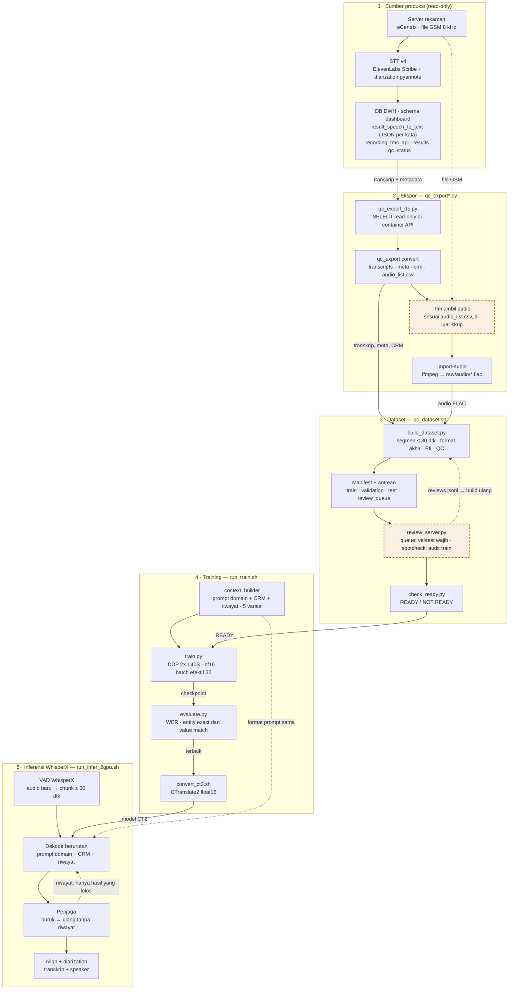

# Fine-tune Whisper untuk WhisperX – Telemarketing

Fine-tuning Whisper untuk transkripsi percakapan telemarketing berbahasa Indonesia, dengan dua target utama:

1. Akurasi PII dan angka dalam **format akhir** (`Rp15.000.000`, `17-08-1985`, `081234567890`).
2. **Konteks percakapan berkelanjutan**: tiap potongan audio ditranskripsi dengan mengetahui isi percakapan sebelumnya.

Model hasil fine-tune dikonversi ke CTranslate2 dan dipakai sebagai model ASR di pipeline WhisperX (VAD, alignment, dan diarization tetap dari WhisperX).

## Alur



Kotak oranye bergaris putus-putus adalah langkah yang dikerjakan manusia. Panduan langkah demi langkah ada di [docs/HOW_TO_TRAIN.md](docs/HOW_TO_TRAIN.md).

## Dokumen

| File | Isi |
| --- | --- |
| [docs/HOW_TO_TRAIN.md](docs/HOW_TO_TRAIN.md) | **Mulai di sini:** langkah training dari audio sampai model terpakai di WhisperX |
| [PLAN.md](PLAN.md) | Rencana kerja per fase, status, dan kriteria selesai |
| [docs/SPEC.md](docs/SPEC.md) | Spesifikasi dataset: input ElevenLabs, manifest, segmentasi, konvensi angka & PII, QC, split |
| [docs/CONTEXT_ENGINEERING.md](docs/CONTEXT_ENGINEERING.md) | Cara WhisperX "mengetahui" konteks: lapisan prompt, token budget, training & inferensi |
| [docs/TRAINING_DUAL_GPU.md](docs/TRAINING_DUAL_GPU.md) | Training di 2× L40S dengan DDP: environment, konfigurasi, memori, troubleshooting |

## Kode

| File | Fungsi | Env | Diuji |
| --- | --- | --- | --- |
| `src/qc_export_db.py` | Ekspor read-only dari DB QC dashboard (dijalankan di container API) | container API | dijalankan pada data asli |
| `src/qc_export.py` | `convert`: transkrip/meta/CRM/`audio_list.csv`; `import-audio`: audio yang diambil manual → FLAC | train | unit test + data asli |
| `src/check_ready.py` | Cek siap training → `READY.json` | train | end-to-end |
| `scripts/qc_dataset.sh` | Alur QC dashboard: export, import-audio, dry-run, build, review, check | — | dijalankan (export, dry-run) |
| `src/normalize.py` | Teks ElevenLabs → format akhir; deteksi `pii_types`, `secret`, `needs_review` | train | unit test |
| `src/context_builder.py` | Satu-satunya penyusun prompt (training & inferensi), variasi prompt, label masking | train / infer | unit test |
| `src/build_dataset.py` | Segmentasi, normalisasi, review, QC, split, clip FLAC, manifest, `stats.json` | train | end-to-end, data sintetis |
| `src/review_server.py` | Web UI review (stdlib), menulis `dataset/reviews.jsonl` | train | end-to-end |
| `src/train.py` | Fine-tuning DDP dengan collator berkonteks | train | collator saja* |
| `src/evaluate.py` | `predict` (checkpoint HF) dan `score` (WER/CER, entity exact/value match, digit error) | train | `score` saja |
| `src/infer_context.py` | Inferensi WhisperX level 1/2 + mode manifest untuk ablation | infer | loop konteks (ASR tiruan) |
| `src/nccl_check.py` | Cek DDP/NCCL 2 GPU | train | dijalankan, lolos |
| `scripts/*.sh` | Setup env, build dataset, training, konversi CT2, inferensi 2 GPU, test | — | cek sintaks |

\* Test collator butuh file processor Whisper large-v3 di cache HF; saat ini dilewati.

## Dataset dari telemarketing-qc-dashboard

```bash
bash scripts/qc_dataset.sh export --scope qc_all       # read-only; TIDAK mengambil audio
#   → raw/audio_list.csv (ticket_id,file_path,...) — ambil sendiri audio yang dipilih ke satu folder
bash scripts/qc_dataset.sh import-audio /path/folder   # → raw/audio/<ticket_id>.flac
bash scripts/qc_dataset.sh build                       # --pii-policy confidence (default)
bash scripts/qc_dataset.sh review <nama> queue         # wajib: validation/test (+ PII sisa)
bash scripts/qc_dataset.sh review <nama> spotcheck     # audit label otomatis train
bash scripts/qc_dataset.sh build                       # ulangi setelah review
bash scripts/qc_dataset.sh check                       # READY / NOT READY
```

Status 2026-11-01:
- Export selesai: 2.295 panggilan (±412 jam), transkrip ElevenLabs di `raw/transcripts/`, daftar audio di `raw/audio_list.csv`.
- Audio belum ada.
- Dry-run dengan `--pii-policy confidence` (default): train ±265 jam (22,7% PII), review wajib validation/test ±1.500 segmen.

## Urutan menjalankan (umum)

```bash
bash scripts/setup_envs.sh train          # sekali; lalu: bash scripts/setup_envs.sh infer
bash scripts/run_tests.sh                 # unit test

# data asli: raw/audio/<call_id>.wav + raw/transcripts/<call_id>.json (+ raw/crm.jsonl opsional)
bash scripts/build_dataset.sh             # → dataset/, review_queue.jsonl
.envs/whisper-train/bin/python src/review_server.py --reviewer <nama>   # review PII + val/test
bash scripts/build_dataset.sh             # ulangi setelah review

bash scripts/run_train.sh smoke && bash scripts/run_train.sh smoke-ddp
bash scripts/run_train.sh full run-001

.envs/whisper-train/bin/python src/evaluate.py predict --model outputs/run-001/checkpoint-XXXX \
    --manifest dataset/validation.jsonl --prompt domain --out outputs/preds/val.jsonl
.envs/whisper-train/bin/python src/evaluate.py score --manifest dataset/validation.jsonl --pred outputs/preds/val.jsonl

bash scripts/convert_ct2.sh outputs/run-001/final outputs/whisper-telemarketing-ct2
bash scripts/run_infer_2gpu.sh manifest --model outputs/whisper-telemarketing-ct2 \
    --manifest dataset/test.jsonl --out outputs/preds/test-C4.jsonl
bash scripts/run_infer_2gpu.sh audio --model outputs/whisper-telemarketing-ct2 \
    --audio-dir raw/audio --out-dir outputs/transcripts
```

## Hardware

| Komponen | Nilai |
| --- | --- |
| GPU | 2× NVIDIA L40S, 48 GB, driver 580 |
| Interkoneksi GPU | PCIe (`PHB`), tanpa NVLink; all-reduce NCCL lolos tanpa `NCCL_P2P_DISABLE` |
| CPU / RAM | 24 core / 62 GB |
| Disk `/data` | 300 GB, sisa ±113 GB (per 2026-10-28) |
| Disk `/home` | sisa ±9 GB, karena itu env & cache ada di `.envs/` dan `.cache/` di proyek ini |

## Struktur direktori

```
/data/finetune_whisper/
├── README.md, PLAN.md, pytest.ini, requirements-*.txt
├── docs/          spec & panduan
├── configs/       domain_prompt.txt
├── src/           kode (tabel di atas)
├── tests/         unit & end-to-end test (data sintetis, tanpa PII)
├── scripts/       skrip shell
├── raw/           input read-only (chmod 700)
├── dataset/       clips/, *.jsonl, stats.json (chmod 700)
├── outputs/       checkpoint, model CT2, prediksi, laporan (chmod 700)
├── .envs/         whisper-train, whisperx-infer
└── .cache/        pip & huggingface
```

## Data rahasia

Dataset dan model berisi PII nasabah. `raw/`, `dataset/`, dan `outputs/` hanya untuk tim training, tidak boleh di-commit, diunggah ke layanan eksternal, atau dibagikan. `review_server.py` default hanya bind ke `127.0.0.1`. Lihat bagian Privasi di [docs/SPEC.md](docs/SPEC.md).
